# PageChat Code Guide

This guide explains what the files and functions in this repository do in plain English. It also separates **fixed choices** (values written directly in the code) from **runtime logic** (what the code decides after it sees a page or question).

## The whole flow

```mermaid
flowchart LR
    A[Open PageChat] --> B[Side panel finds active tab]
    B --> C[Background worker checks page URL]
    C --> D[Content code reads page title, product details, reviews and text]
    D --> E[Side panel shows page type and quick questions]
    E --> F[User asks a question]
    F --> G[Backend builds and ranks text chunks]
    G --> H[Ollama writes an answer]
    H --> I[Answer streams into chat and chat is saved for this URL]
```

In short: Chrome reads the page, the local FastAPI backend selects relevant text, Ollama answers from that text, and the side panel displays the answer.

## Fixed choices and dynamic logic

### Fixed choices written into the project

- The extension is named PageChat and uses Chrome Manifest V3.
- The default backend is `http://localhost:8000`.
- The default Ollama model is `llama3.2:3b`; `OLLAMA_MODEL` can override it.
- Amazon, Flipkart and IMDb have predefined CSS selectors in `extension/selectors.js`.
- The sensitive-URL block patterns live in `extension/background.js`.
- Page fallback text is limited to 20,000 characters; a chat request is limited to 30,000 characters.
- The backend splits text into 1,000-character pieces with 150 characters of overlap and selects four pieces for a normal question.
- The backend includes up to six prior chat messages in the model prompt.
- Chat history is stored by page URL in Chrome session storage.
- The prompts define how each page type should be answered. The model does not get to change those rules.

### Logic that runs on the actual page and question

- The active tab, URL, page title, text, site, product fields, reviews and JSON-LD are read at runtime.
- The extension decides a page type from its structured data, URL and page elements.
- The backend ranks page chunks using words in the user's question. Negative-review questions receive extra weight for low-star ratings and complaint words.
- Ollama generates the answer from the selected page chunks and the conversation context.
- The tab and URL events decide when page data needs refreshing.

## Extension files

### `extension/manifest.json`

Chrome's extension configuration. It declares the extension name/version, permissions, backend host permissions, background worker, side panel page and icon sizes. These are configuration values, not functions.

The current permissions include `activeTab`, `scripting`, `sidePanel`, `storage` and `tabs`. Host access currently includes HTTP and HTTPS pages. Chrome uses these values to decide what the extension may access.

### `extension/background.js`

Runs as the extension's background service worker. It opens the panel, remembers the selected tab, blocks sensitive pages, injects page-reading scripts, and passes URL-change messages to the side panel.

- `extractFromTab(tabId, options)` injects `Readability.js`, `selectors.js` and `content.js` into the selected tab. It then calls `window.getPageData(options)`. If injection or extraction fails, it returns an object containing `error`.
- The `chrome.action.onClicked` handler remembers the tab where the PageChat toolbar icon was clicked and opens the panel for that tab.
- The `chrome.tabs.onActivated` handler updates the remembered tab when the active tab changes.
- The `chrome.runtime.onMessage` handler routes messages:
  - `PAGE_INFO`: finds the tab's URL and title for the side panel.
  - `EXTRACT`: checks the page URL against the block list, then calls `extractFromTab`.
  - `URL_CHANGED`: receives a single-page-app navigation notice from the page and sends `ACTIVE_PAGE_CHANGED` to the extension UI.
- The small `reply(value)` helper logs and returns the response for `PAGE_INFO` and `EXTRACT`.

The block list and log statements are fixed code. Which tab is handled and whether its URL matches a block pattern are decided at runtime.

### `extension/content.js`

Runs inside the current page when the background worker injects it. It reads page information; it does not call Ollama or the backend itself.

- The URL watcher uses a `MutationObserver`, `popstate` and `hashchange` to notice single-page-app navigation. It sends `URL_CHANGED` when it detects a different `location.href`.
- `clean(text)` redacts email-like, phone-like and card-like strings, then caps the text length.
- `text(selector)` collects visible text from matching page elements.
- `collectReviews(root, selectors)` gets review text and star ratings from review cards. It falls back to the site's review text selector if there are no matching cards.
- `value(selector)` returns the first matching text value, or an empty string.
- `select(selectors, key)` returns all values for one selector name, or an empty list.
- `jsonData()` parses JSON-LD script elements on the page.
- `flatten(data)` expands JSON-LD `@graph` objects into separate entries.
- `waitFor(selector, timeout)` waits for a page element to appear, using a `MutationObserver` and timeout.
- `detectSite()` maps the current hostname to a known site name, or returns the hostname for an unlisted site.
- `detectPageType(site, jsonld, selectors)` uses product/movie/article JSON-LD, supported sites, price and page content to classify the page.
- `loadMoreReviews(selectors)` scrolls/clicks review controls and tries up to three review links when more reviews were requested. It uses the current browser session's credentials for those page requests.
- `window.getPageData(options)` is the main extraction function. It gathers selectors and JSON-LD, optionally loads more reviews, uses Readability or body text as fallback, sanitizes text, and returns the page data object.

The selector names and redaction patterns are fixed. The function results depend on the site's live DOM and on whether the requested page actually exposes reviews.

### `extension/selectors.js`

One place for per-site CSS selectors. Amazon selectors include review card, review text and rating fields; Flipkart and IMDb have their own fields. These selectors are predefined guesses about site markup and may need maintenance when a site changes.

### `extension/lib/Readability.js` and `extension/lib/LICENSE-2.0.txt`

Mozilla's bundled Readability library and its Apache 2.0 license. PageChat uses it to try to isolate article text before falling back to the page's body text. It is third-party code, not a PageChat-written function.

### `extension/sidepanel/sidepanel.html`

The side panel's fixed HTML structure: header, page label, quick-action area, chat container, review checkbox, question input, buttons and footer.

### `extension/sidepanel/sidepanel.css`

The panel's appearance. It uses a black background, gold accents, white chat/input text, Times New Roman, message bubble styles, focus states, and responsive flex layout. These are fixed design choices.

### `extension/sidepanel/sidepanel.js`

Controls the interactive panel and its connection to Chrome and the backend.

- `$(id)` is a short helper for finding an HTML element by its ID.
- `escapeHtml(text)` converts special characters so model/user text cannot be treated as HTML markup.
- `formatMarkdown(text)` creates a small safe subset of Markdown: paragraphs, bold text and bullet lists.
- `scrollBottom()` moves the chat view to its latest message.
- `removeEmpty()` removes the starter message when the first chat item is added.
- `storageKey()` builds the session-storage key from the active page URL.
- `addMessage(role, content, options)` creates and displays a user or assistant bubble. Assistant bubbles get Copy; errors may get Retry.
- `saveMessages()` saves up to 60 chat items for the current URL in `chrome.storage.session`.
- `loadMessages()` loads that URL's saved conversation or shows the starter message.
- `setStatus(text)` updates the small page/status label in the header.
- `backendUrl()` reads the configured backend URL from Chrome local storage or uses localhost.
- `updateChips()` picks quick-action labels based on the extracted page type.
- `extract(force, tabId, includeMoreReviews)` asks the background worker to read the current page and caches the result in panel memory. Review questions can request expanded review extraction automatically.
- `getActiveTab()` uses `chrome.tabs.query` to find the active tab, preferring the last-focused browser window.
- `syncActivePage(tabId)` obtains the tab URL/title, changes the URL-based chat history when needed, and rejects non-web pages.
- `historyForRequest()` formats up to six previous messages for the backend.
- `ask(question)` shows the user message, extracts page data if necessary, trims the request to its size limit, posts to `/chat`, streams the answer, and handles stop, timeout and errors.
- `compareCurrent()` saves product details locally and displays a table comparing the two most recently saved products.
- `resizeInput()` adjusts the textarea height to its text.
- `updateActiveTab()` refreshes local tab tracking and loads the conversation for that URL.
- `refreshPageForTab(tabId, force)` refreshes data after a tab activation or completed navigation. If a chat is already running, it defers the refresh until the chat finishes.
- The tab event handlers listen for tab activation, completed navigation and `ACTIVE_PAGE_CHANGED` from the background worker.
- `startupReady` loads settings and initializes the active tab/page when the panel starts.

The page types, chips, timeout and storage rules are fixed. The selected chip, active URL, extracted data, chat messages and returned answer are dynamic.

### `extension/generate_icons.py` and `extension/icons/*.png`

The Python script makes simple RGBA PNG chat icons at 16, 48 and 128 pixels. `chunk(kind, data)` writes a PNG data block, `pixel(x, y, size)` calculates a pixel's color, and `write_png(size)` assembles and compresses one PNG. The sizes and indigo/white palette are fixed.

## Backend files

### `backend/main.py`

The FastAPI HTTP server. It accepts page data from the extension and routes it to the pipeline.

- `ChatPayload` describes the expected request fields: URL, site, structured data, JSON-LD, fallback text, question, history and page type.
- `_doc_or_error(payload)` calls `build_docs()` and returns a document or no document when there is no readable page text.
- `health()` serves `GET /health` and returns `{"ok": true}`.
- `chat(payload)` validates that page text and a question are present, starts answer generation, then streams text chunks as the response body. Errors before streaming starts return JSON with an error message.
- The nested `generate()` function yields the first model chunk and then the remaining chunks to the HTTP response.
- `summarize_page(payload)` summarizes a page with the `/summarize` route and returns JSON.

CORS settings, routes and request fields are predetermined. The actual page content, question, and model output are supplied at runtime.

### `backend/pipeline.py`

Prepares page text, selects useful pieces, and calls local Ollama.

- `build_docs(payload)` turns structured data, JSON-LD and fallback text into one LangChain `Document`. It labels review excerpts and caps long inputs.
- `_cache_key(doc)` hashes the URL and page text so repeated requests can reuse split chunks.
- `_get_chunks(doc)` splits a page into chunks and keeps up to 20 page entries in an in-memory cache.
- `_rank_chunks(chunks, question, limit)` scores chunks by overlap with question words. For negative/complaint queries, it boosts low-star ratings and common complaint words.
- `retrieve(doc, question, summarize)` returns the best four chunks for a question; summaries use the first chunks and review-related chunks.
- `_llm()` creates `ChatOllama` using `OLLAMA_BASE_URL` and `OLLAMA_MODEL`. The model, context size, temperature, output cap and timeout are configuration choices.
- `_messages(payload, question, docs)` builds the system instructions, page context, last six conversation messages and current question for the model.
- `stream_answer(payload, question, doc)` retrieves chunks and returns the model's streaming response.
- `summarize(payload, doc)` retrieves summary context and invokes the model without streaming.

The word-ranking method is simple and deterministic; it is not semantic search. A question using words close to the page text is more likely to retrieve the intended chunk.

### `backend/prompts.py`

Contains fixed system instructions for shopping, movie, article and other pages. `system_prompt(page_type)` chooses the matching instruction, defaulting to `other` for unknown types. The model's prose is dynamic, but these answer rules are predetermined.

### `backend/requirements.txt`

Lists Python packages installed for the API, LangChain document handling, Ollama connection, environment variables and request validation. It deliberately does not require Torch-based sentence-transformer indexing.

### `backend/.env.example` and `backend/.env`

`.env.example` documents `OLLAMA_BASE_URL` and `OLLAMA_MODEL`. `.env` is the local working configuration and is ignored by Git; keep private/local values there. No cloud LLM API key is needed for the configured local Ollama model.

### `backend/test_curl.sh`

A sample shell command that posts an example article question to `POST /chat`. It is for manual API checking.

## Project-level files

- `README.md` explains setup, running the backend, loading the extension, maintaining selectors and deployment notes.
- `.gitignore` excludes the local environment file, virtual environment, Python cache and compiled Python files.
- `.vscode/settings.json` tells VS Code to use environment variables from an environment file in its Python terminal.
- `.venv` and `.venv-1` are local Python environments, not PageChat source code. They hold installed packages for development.

## What is intentionally not automatic

- The extension does not inject a content script on every website at browser startup. It injects when PageChat requests page extraction.
- The local Ollama model does not browse the internet. It answers from the page text supplied in the request.
- The extension does not use a build system or JavaScript framework. The code runs as plain JavaScript in Chrome.
